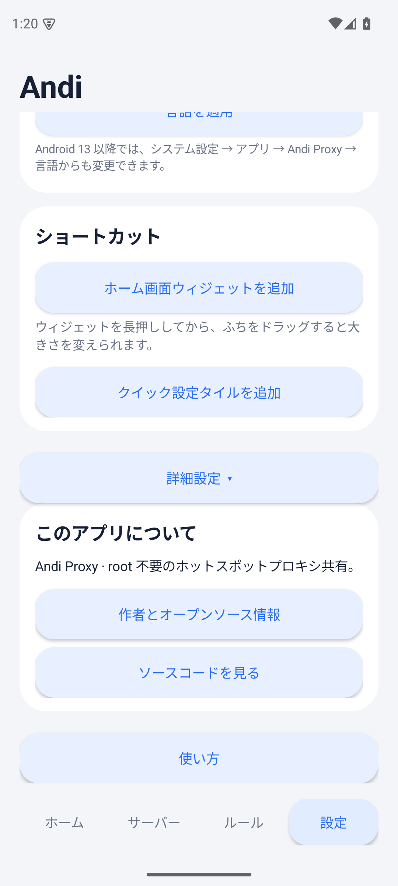
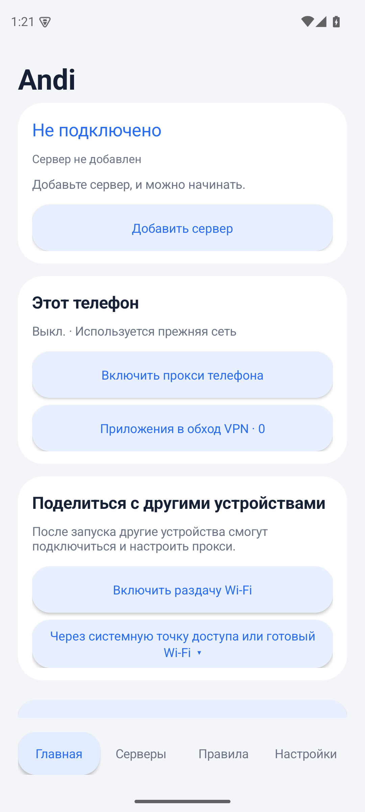

<div align="center">


# Andi Proxy

**당신의 핫스팟. 당신의 규칙.**

Hysteria2 또는 SOCKS5 프록시 하나를 Android 핫스팟에 연결된 모든 기기와 공유하세요. root는 필요 없습니다.

[](https://github.com/kongdayan/andi-proxy/actions/workflows/ci.yml)
[](https://github.com/kongdayan/andi-proxy/releases/latest)
[](LICENSE)
[](https://github.com/kongdayan/andi-proxy/releases/latest)
[](#언어)

[English](README.md) · [简体中文](README.zh-CN.md) · [日本語](README.ja.md) · [한국어](README.ko.md) · [Русский](README.ru.md)

</div>

Andi Proxy는 평범한 Android 휴대폰을 작고 자립적인 프록시 게이트웨이로 바꿔 줍니다. Hysteria2 또는 인증이 필요한 SOCKS5 업스트림에 연결한 다음, 휴대폰 자체를 로컬 VPN으로 라우팅하거나, 휴대폰 핫스팟 또는 기존 Wi-Fi LAN을 통해 노트북, 태블릿, 다른 휴대폰과 프록시를 공유할 수 있습니다.

root도, `iptables`도, 상시 원격 제어도, 숨겨진 클라우드도 없습니다. 핫스팟 클라이언트는 Wi-Fi 프록시를 `phone-address:2080`으로 지정하면 되고, 휴대폰 자체 앱은 앱별 제외를 지원하는 로컬 VPN을 통해 같은 규칙 엔진을 사용할 수 있습니다.

> **핫스팟 클라이언트는 프록시를 직접 설정해야 합니다.** 휴대폰 VPN은 휴대폰 앱에만 적용되며, 다른 기기의 트래픽에는 적용되지 않습니다. 이는 root가 필요 없는 현실적인 설계입니다. 일반 앱은 핫스팟의 커널 포워딩 경로를 투명하게 가로챌 수 없습니다. SOCKS5를 지원하는 클라이언트는 같은 주소와 포트를 사용할 수 있습니다.


## Andi Proxy를 선택하는 이유

- **업스트림 하나, 두 가지 공유 방식.** 이 휴대폰에서 프록시를 사용하거나, 다른 기기와 공유하거나, 둘 다 동시에 할 수 있습니다. 공유를 중지해도 휴대폰 VPN은 계속 실행됩니다.
- **진짜 규칙 기반 라우팅.** Shadowrocket 규칙 목록과 구성 파일을 가져오거나 도메인, CIDR, 기본 경로 규칙을 직접 작성할 수 있습니다. `DIRECT`, `PROXY`, `REJECT`가 모두 동작합니다.
- **필요한 곳에 정확히 적용되는 인증.** Hysteria2 비밀번호, SOCKS5 사용자 이름/비밀번호, 선택적 로컬 프록시 인증, TLS SNI, Salamander 난독화를 지원합니다.
- **자격 증명은 휴대폰에만.** 구성은 Android Keystore로 암호화되고 백업에서 제외됩니다. 분석, 광고, 텔레메트리는 없습니다.
- **일반 휴대폰을 위한 설계.** root도, 커널 모듈도, 별도 VPN 앱도 필요 없습니다. 시중에 판매되는 Android 16 arm64 휴대폰에서 테스트했습니다.
- **다섯 가지 UI 언어.** 영어, 중국어 간체, 일본어, 한국어, 러시아어를 지원하며, 앱 안에서 또는 Android의 앱별 언어 설정에서 전환할 수 있습니다.
- **오픈소스, 재현 가능한 빌드.** GitHub Actions가 ABI별로 APK를 하나씩 빌드하고 서명하며, 태그마다 SHA-256 체크섬과 함께 공개합니다.

## 스크린샷

| Settings | About | Languages |
| --- | --- | --- |
|  |  |  |

스크린샷은 영어 UI입니다. 앱은 중국어(간체), 일본어, 한국어, 러시아어도 지원합니다. 설정 → 언어 또는 Android의 앱별 언어 설정에서 변경할 수 있습니다.

| Japanese About | Russian home |
| --- | --- |
|  |  |

## 기능

| 영역 | 제공 기능 |
| --- | --- |
| 업스트림 | TLS SNI, 인증서 검증 토글, Salamander 난독화를 지원하는 Hysteria2, 필수 사용자 이름/비밀번호와 선택적 UDP를 지원하는 SOCKS5 |
| 공유 | 앱이 직접 만드는 로컬 전용 핫스팟, 시스템 핫스팟 진입점, 기존 Wi-Fi/LAN 인터페이스 공유, `2080` 포트의 HTTP CONNECT 및 SOCKS5 |
| 휴대폰 VPN | hev-socks5-tunnel을 거치는 동일한 sing-box 코어, 시스템 앱까지 검색할 수 있는 앱별 다이렉트 목록, Andi는 항상 자기 자신을 제외 |
| 규칙 | `DOMAIN`, `DOMAIN-SUFFIX`, `DOMAIN-KEYWORD`, IPv4/IPv6 CIDR, `GEOIP`, `FINAL`/`MATCH`, 수동 규칙, 사설망 다이렉트, 구독 규칙의 원래 순서 |
| DNS | 프록시 대상 도메인은 원격 Cloudflare DoH, 다이렉트 도메인은 `223.5.5.5`, 서버 호스트 이름은 다이렉트 부트스트랩, DNS 루프 없음 |
| 구독 | Shadowrocket `.conf` 및 규칙 목록, HTTPS 전용, 크기 제한, 원자적 캐시, 시작 시점에 24시간이 지난 캐시 갱신, 캐시 교체 전 검증 |
| UI | One UI 스타일 카드, 라이트/다크/시스템 테마, 큰 화면과 컴팩트 레이아웃, 홈 화면 위젯, Quick Settings 타일, 길게 누르기 바로가기 |
| 개인정보 | Android Keystore를 통한 AES-GCM 구성 암호화, 백업 비활성화, 텔레메트리 없음, 원격 제어 서비스 없음 |

## 설치

사용 중인 기기에 맞는 APK를 [최신 릴리스](https://github.com/kongdayan/andi-proxy/releases/latest)에서 내려받으세요.

| 기기 | APK |
| --- | --- |
| 대부분의 최신 휴대폰(64비트 ARM) | [AndiProxy-arm64-v8a.apk](https://github.com/kongdayan/andi-proxy/releases/latest/download/AndiProxy-arm64-v8a.apk) |
| 구형 32비트 ARM 휴대폰 | [AndiProxy-armeabi-v7a.apk](https://github.com/kongdayan/andi-proxy/releases/latest/download/AndiProxy-armeabi-v7a.apk) |
| x86_64 에뮬레이터 및 태블릿 | [AndiProxy-x86_64.apk](https://github.com/kongdayan/andi-proxy/releases/latest/download/AndiProxy-x86_64.apk) |
| 레거시 x86 에뮬레이터 | [AndiProxy-x86.apk](https://github.com/kongdayan/andi-proxy/releases/latest/download/AndiProxy-x86.apk) |
| 잘 모르겠다면 / 모든 기기용 단일 파일 | [AndiProxy-universal.apk](https://github.com/kongdayan/andi-proxy/releases/latest/download/AndiProxy-universal.apk) |

**Android 8.0(API 26)** 이상이 필요합니다. 유니버설 APK는 용량이 훨씬 크므로 ABI 전용 파일을 권장합니다. 각 릴리스에는 `SHA256SUMS`와 APK 서명 방식을 설명하는 `SIGNING.txt`가 포함됩니다. 1.0.0 이전 개발 빌드를 설치했다면 먼저 제거하세요. 공개 릴리스는 새 서명 키를 사용합니다.

Android에서 앱 스토어를 통해 설치되지 않았다는 경고가 표시될 수 있습니다. 오픈소스 APK를 직접 설치할 때 나타나는 정상적인 경고입니다. 이 프로젝트는 Google Play에 배포되지 않습니다.

## 빠른 시작

1. **서버 추가.** **서버** 화면을 열고 HY2/SOCKS5 JSON 구성을 가져오거나 주소, 포트, 자격 증명을 직접 입력한 뒤 저장하세요.
2. **이 휴대폰에 프록시 적용.** 홈에서 **기기 프록시 켜기**를 탭하고 VPN 요청을 허용하세요. 다이렉트로 연결할 앱을 검색해 선택하려면 **VPN 제외 앱**을 여세요.
3. **다른 기기와 공유.** **Wi-Fi 공유 시작** → **다른 기기 연결**을 탭하세요. 표시된 Wi-Fi에 접속한 다음 클라이언트의 Wi-Fi 프록시를 **수동**으로 설정하고, 표시된 서버 주소와 `2080` 포트를 입력하세요. SOCKS5를 지원하는 클라이언트는 같은 주소와 포트를 사용합니다.
4. **라우팅 조정.** **규칙**을 열어 Shadowrocket 구독을 붙여넣고 즉시 업데이트하거나 도메인/CIDR 규칙을 직접 작성하세요. 규칙, 서버, 제외 설정은 실행 중인 프록시에 자동으로 적용됩니다.

클라이언트에서 Wi-Fi에 인터넷이 없다고 표시되면 **연결 유지**를 선택하세요. 핫스팟은 로컬 연결만 제공하며, 인터넷 접속은 프록시를 거칩니다.

## 동작 방식

```text
            ┌──────────────────────────── Android phone ────────────────────────────┐
            │                                                                       │
  Wi-Fi/LAN │  other devices ── HTTP CONNECT / SOCKS5 :2080 ──┐                    │
            │                                                  │                   │
            │  phone apps ── VpnService ── hev-socks5-tunnel ──┤                   │
            │                    (per-app exclusions)          ▼                   │
            │                                            sing-box 1.14.2            │
            │                                         rules / DNS / routing         │
            └──────────────────────────────────────────────────┬───────────────────┘
                                                               │
                                              Hysteria2 or authenticated SOCKS5
                                                               ▼
                                                          upstream
```

- 포그라운드 서비스가 생성된 구성과 함께 고정된 sing-box 코어를 시작합니다. 구성은 앱의 전용 디렉터리에 `0600` 권한으로 저장되며 세션이 중지되면 삭제됩니다.
- 로컬 혼합 인바운드가 `2080`에서 수신하며 HTTP CONNECT와 SOCKS5를 받아들입니다. 공유는 명시적으로 이루어집니다. 즉, 클라이언트가 프록시를 직접 설정해야 합니다.
- 휴대폰 VPN은 `hev-socks5-tunnel`을 사용해 TUN 패킷을 `2081`의 루프백 전용 SOCKS 리스너로 전달하므로, 휴대폰과 핫스팟 클라이언트가 동일한 라우팅 엔진을 공유합니다.
- Android는 VPN을 하나만 활성화할 수 있습니다. Andi는 라우팅 루프를 피하기 위해 자체 VPN에서 자기 자신을 제외합니다.
- 코어 바이너리는 `libsingbox.so`로 패키징되어 Android가 앱의 네이티브 라이브러리 디렉터리에 추출합니다. 앱은 쓰기 가능한 디렉터리로 내려받은 코드를 실행하지 않습니다.

구성 요소 맵과 데이터 흐름은 [아키텍처](docs/ARCHITECTURE.md)에서 확인하세요.

## 규칙과 DNS

라우팅 우선순위:

1. 수동 프록시 도메인
2. 수동 다이렉트 도메인
3. 수동 다이렉트 CIDR
4. 사설망 다이렉트
5. 구독 규칙(원래 순서 유지)
6. 최종 경로

구독의 `FINAL`은 수동 기본 경로를 덮어씁니다. `FINAL`이 없으면 수동 기본 경로가 유지됩니다. IP 규칙은 필요할 때 명시적으로 도메인을 확인하며, `no-resolve` 규칙은 추가 조회를 일으키지 않습니다.

수동 규칙과 구독 도메인 규칙은 리졸버도 결정합니다. 프록시 대상 도메인은 원격 Cloudflare DoH를, 다이렉트 도메인은 `223.5.5.5`를 사용하며, 서버 호스트 이름은 루프를 피하기 위해 다이렉트 DNS로 부트스트랩합니다. 국가 규칙은 확인된 목적지 IP를 사용합니다. 프록시를 사용하지 않는 클라이언트가 보내는 DNS 쿼리는 핫스팟 공유에서 가로채지 않으며, 휴대폰 VPN은 터널 내부의 DNS를 캡처해 동일한 코어로 보냅니다.

`[Rule]` 섹션만 가져옵니다. MITM, 인증서 설정, URL 재작성, General 시스템 설정은 무시됩니다. 지원하지 않는 라우팅 항목이 있으면 업데이트가 실패하고 이전 캐시가 유지되며, 해당 항목이 조용히 누락되는 일은 없습니다.

## 개인정보 보호 및 보안

- 서버 자격 증명과 구성은 Android Keystore AES-GCM 키로 암호화됩니다. 이 앱은 Android 백업과 기기 이전 대상에서 제외됩니다.
- 실행 중인 코어 구성은 `0600` 권한으로 기록되며 중지 시 삭제됩니다. 구독 검증 구성은 임시로만 사용됩니다.
- 구독은 자격 증명이나 프래그먼트가 포함되지 않은 HTTPS를 사용해야 합니다. 다운로드는 크기가 제한되며 리디렉션을 검사합니다.
- 분석, 광고, 텔레메트리, 원격 제어 서비스가 없습니다. 앱은 구성이나 사용 데이터를 업로드하지 않습니다.
- 바이너리와 네이티브 라이브러리는 고정된 공식 업스트림 릴리스이며, [`scripts/fetch-core.py`](scripts/fetch-core.py)에서 SHA-256으로 검증합니다.

[개인정보 보호](docs/PRIVACY.md)와 [서드파티 고지](THIRD_PARTY_NOTICES.md)를 참고하세요.

## 호환성과 제한

- **검증된 플랫폼:** 시중에 판매되는 Android 16.0 휴대폰, arm64-v8a, 4 KiB 메모리 페이지, root 없음. 다른 ABI와 16 KiB 페이지 크기 기기는 빌드되지만 아직 실기기에서 검증되지 않았습니다. 제보를 환영합니다.
- **핫스팟 클라이언트:** 앱은 `LocalOnlyHotspot`을 생성하며, Android 16.0에서는 이름과 비밀번호를 시스템이 생성합니다. 고정된 이름/비밀번호를 쓰려면 시스템 핫스팟을 설정하고 그 인터페이스를 대신 공유하세요. 앱이 핫스팟 이름을 지정하는 Android 16.1 API는 컴파일되어 있지만 실기기에서 검증되지는 않았습니다.
- **투명 프록시 아님:** 핫스팟 클라이언트는 HTTP/SOCKS5 프록시를 설정해야 합니다. 게임, UDP 전용 앱, 기기 전체 프록시는 클라이언트 측 SOCKS5/VPN/TUN 도구가 필요합니다.
- **VPN은 한 번에 하나:** Android는 VPN 두 개를 동시에 활성화할 수 없습니다. Andi는 다른 VPN 서비스와 함께 실행할 수 없습니다.
- **구독은 사용자가 제공:** 규칙 콘텐츠와 그 라이선스는 구독자의 책임입니다. 라우팅 규칙만 사용됩니다.
- **Play 스토어 배포 없음:** APK를 직접 설치하고, 미러에서 내려받았다면 체크섬을 확인하세요.

과거 검증 내역과 남은 예외 상황은 [검증](docs/VERIFICATION.md)에 정리되어 있습니다.

## 언어

앱 UI는 다음 언어를 지원합니다.

- 영어(중국어 이외 시스템 로캘의 기본값)
- 简体中文(중국어 간체)
- 日本語(일본어)
- 한국어
- Русский(러시아어)

**설정 → 언어**에서 변경하거나, Android 13 이상에서는 **시스템 설정 → 앱 → Andi Proxy → 언어**에서 변경할 수 있습니다. 번역은 [`app/src/main/assets/i18n/`](app/src/main/assets/i18n/)에 있으며, 중국어 원본 문자열이 조회 키로 사용됩니다. 표를 수정한 뒤에는 `python3 scripts/check-i18n.py`를 실행하세요. 번역 수정 제안도 환영합니다.

## 소스에서 빌드

요구 사항: JDK 17, Android SDK Platform 36, Build Tools 35.0.0, Python 3.10 이상.

```sh
git clone https://github.com/kongdayan/andi-proxy.git
cd andi-proxy

# Download the pinned sing-box and hev-socks5-tunnel binaries (all ABIs + macOS host core)
python3 scripts/fetch-core.py

# Point Gradle at your SDK if ANDROID_HOME is not already set
export ANDROID_HOME=/path/to/android-sdk

./gradlew :app:testDebugUnitTest :app:lintDebug :app:assembleDebug
```

디버그 APK는 ABI별로 `app/build/outputs/apk/debug/`에 생성됩니다. 릴리스 빌드도 같은 ABI 분할을 사용하며, 서명, 버전 관리, 릴리스에 대한 자세한 내용은 [빌드](docs/BUILDING.md)에서 확인하세요.

유용한 검사:

```sh
python3 scripts/check-i18n.py       # translation keys, placeholders and coverage
python3 scripts/core_smoke.py       # real sing-box routing/fixture smoke test (macOS arm64 host core)
```

## 문서

- [Andi Proxy 사용하기](docs/USAGE.md) · [简体中文](docs/USAGE.zh-CN.md) — 설정, 공유, 규칙, 문제 해결
- [아키텍처](docs/ARCHITECTURE.md) — 구성 요소, 데이터 흐름, 저장소, DNS
- [빌드 및 릴리스](docs/BUILDING.md) — SDK 설정, 서명, ABI 분할, CI
- [개인정보 보호](docs/PRIVACY.md) — 저장되는 것, 전송되는 것, 그리고 전송되지 않는 것
- [검증](docs/VERIFICATION.md) — 실기기에서 테스트한 것과 하지 않은 것
- [서드파티 고지](THIRD_PARTY_NOTICES.md) — 버전, 소스 링크, SHA-256 다이제스트
- [과거 개발 노트](docs/development/README.md) — 중국어 설계 및 인수 기록

## 프로젝트 구조

```text
app/src/main/java/com/andi/proxy/   액티비티, 서비스, 규칙 엔진, VPN, 위젯
app/src/main/assets/i18n/           영어, 일본어, 한국어, 러시아어 번역 표
app/src/main/assets/licenses/       APK에 포함되는 GPL, MIT 및 서드파티 고지
app/src/test/                       JVM 단위 테스트
app/src/androidTest/                선택 실행 방식의 기기 스모크 러너
docs/                               사용법, 아키텍처, 빌드, 개인정보 보호, 검증
scripts/                            고정 코어 내려받기, i18n 검증, 스모크 테스트
.github/workflows/                  CI 및 서명된 릴리스 파이프라인
```

## 기여

이슈, 풀 리퀘스트, 기기 제보, 번역 수정을 모두 환영합니다. 먼저 [기여 안내](CONTRIBUTING.md)와 [보안 정책](SECURITY.md)을 읽어 주세요. 버그를 보고할 때는 Android 버전, 기기 모델, ABI, 앱 버전과 함께 휴대폰 VPN, 핫스팟 공유 중 무엇이(또는 둘 다) 활성화되어 있었는지 알려 주세요.

사용자에게 표시되는 문자열을 추가했다면 `app/src/main/assets/i18n/en.json`(가능하면 다른 언어 표도)에 추가하고 `python3 scripts/check-i18n.py`를 실행하세요. 이슈에는 자격 증명, 서버 주소, 개인정보를 절대 올리지 마세요.

## 라이선스

Andi Proxy는 **GPL-3.0-or-later** 라이선스로 배포됩니다. [LICENSE](LICENSE)와 [COPYRIGHT](COPYRIGHT)를 참고하세요. 함께 포함된 sing-box 바이너리는 GPL-3.0-or-later이고, hev-socks5-tunnel은 MIT입니다. 정확한 버전, 소스 링크, SHA-256 다이제스트는 [THIRD_PARTY_NOTICES.md](THIRD_PARTY_NOTICES.md)에 정리되어 있습니다. 앱 아이콘은 직접 제작한 벡터 자산입니다.

이 독립 프로젝트는 SagerNet, sing-box, hev-socks5-tunnel, Samsung, Google과 제휴 관계가 없습니다.

## 작성자 소개

**Andi Proxy**([contributors](https://github.com/kongdayan/andi-proxy))은 상하이에서 활동하는 독립 개발자입니다. Andi Proxy는 Garmin 시계 데이터를 Mac으로 직접 동기화하는 네이티브 macOS 헬스 컴패니언 앱 [the companion project](https://github.com/kongdayan/andi-proxy)의 자매 프로젝트입니다. 두 프로젝트에는 같은 생각이 흐릅니다. 데이터는 사용자의 기기에 두고, 일상적인 도구는 작고 차분하며 믿을 수 있게 만드는 것입니다.

작성자와 프로젝트 링크는 앱의 **설정 → 작성자 및 오픈소스 정보**에도 포함되어 있습니다.
