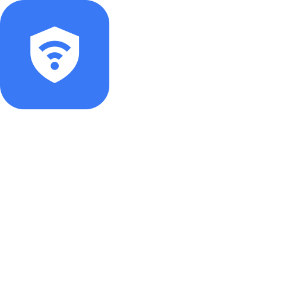
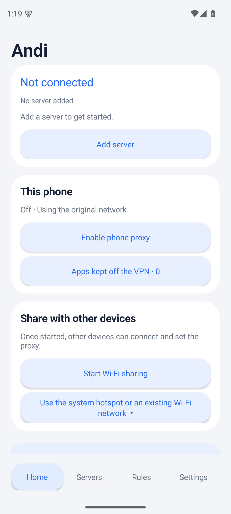
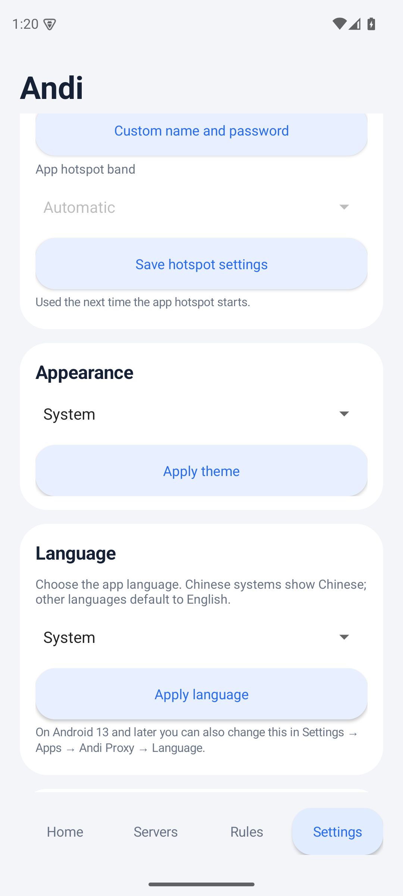
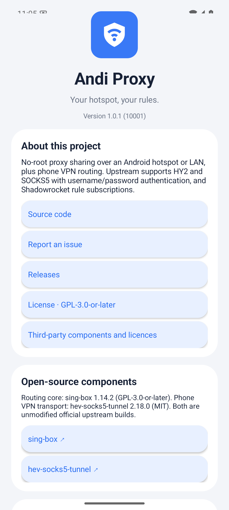
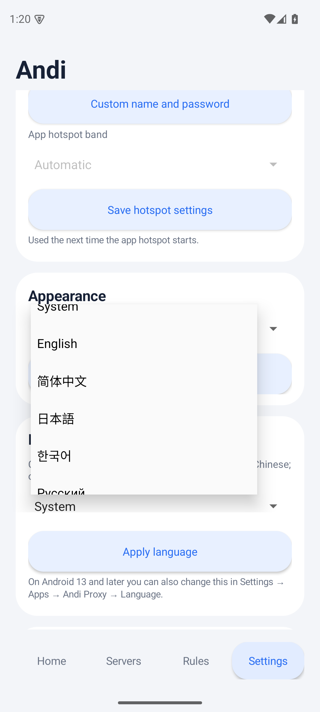

<div align="center">


# Andi Proxy

**Your hotspot. Your rules.**

Share one Hysteria2 or SOCKS5 proxy with every device on your Android hotspot — no root required.

[](https://github.com/kongdayan/andi-proxy/actions/workflows/ci.yml)
[](https://github.com/kongdayan/andi-proxy/releases/latest)
[](LICENSE)
[](https://github.com/kongdayan/andi-proxy/releases/latest)
[](#languages)

[English](README.md) · [简体中文](README.zh-CN.md) · [日本語](README.ja.md) · [한국어](README.ko.md) · [Русский](README.ru.md)

</div>

Andi Proxy turns an ordinary Android phone into a small, self-contained proxy gateway. Connect a Hysteria2 or authenticated SOCKS5 upstream, then either route the phone itself through a local VPN or share the proxy with laptops, tablets and other phones over the phone's hotspot or an existing Wi-Fi LAN.

There is no root, no `iptables`, no always-on remote control, and no hidden cloud. Hotspot clients point their Wi-Fi proxy at `phone-address:2080`; the phone's own apps can use the same rule engine through a local VPN with per-app exclusions.

> **Hotspot clients must set the proxy.** The phone VPN covers the phone's apps, not traffic from other devices. This is the practical, no-root design: a normal app cannot transparently intercept the kernel forwarding path of a hotspot. Clients that support SOCKS5 can use the same address and port.



## Why Andi Proxy

- **One upstream, two ways to share.** Use the proxy on this phone, share it with other devices, or both at once. Stopping sharing keeps the phone VPN running.
- **Real rule routing.** Import Shadowrocket rule lists and config files, or write manual domain, CIDR and default-route rules. `DIRECT`, `PROXY` and `REJECT` all work.
- **Authentication where it belongs.** Hysteria2 passwords, SOCKS5 username/password, optional local proxy authentication, TLS SNI and Salamander obfuscation.
- **Keeps credentials on the phone.** Profiles are encrypted with the Android Keystore and excluded from backup. No analytics, ads or telemetry.
- **Built for ordinary phones.** No root, no kernel modules, no separate VPN app required. Tested on a retail Android 16 arm64 phone.
- **Five UI languages.** English, Simplified Chinese, Japanese, Korean and Russian, switchable in the app or through Android's per-app language settings.
- **Open source, reproducible builds.** GitHub Actions builds and signs one APK per ABI and publishes them with SHA-256 checksums on every tag.

## Screenshots

| Settings | About | Languages |
| --- | --- | --- |
|  |  |  |

The UI is shown in English. The app also ships Simplified Chinese, Japanese, Korean and Russian. Change it in Settings → Language, or in Android's per-app language settings.

## Features

| Area | What you get |
| --- | --- |
| Upstreams | Hysteria2 with TLS SNI, certificate-verification toggle and Salamander obfuscation; SOCKS5 with required username/password and optional UDP |
| Sharing | App-created local-only hotspot, system hotspot entry point, existing Wi-Fi/LAN interface sharing; HTTP CONNECT and SOCKS5 on port `2080` |
| Phone VPN | Same sing-box core through hev-socks5-tunnel; searchable per-app direct list including system apps; Andi always excludes itself |
| Rules | `DOMAIN`, `DOMAIN-SUFFIX`, `DOMAIN-KEYWORD`, IPv4/IPv6 CIDR, `GEOIP`, `FINAL`/`MATCH`; manual rules, private-network direct, subscription order |
| DNS | Remote Cloudflare DoH for proxied domains, `223.5.5.5` for direct domains, direct bootstrap for server hostnames; no DNS loop |
| Subscriptions | Shadowrocket `.conf` and rule lists; HTTPS-only, size-limited, atomic cache, 24-hour startup refresh, validation before replacing the cache |
| UI | One UI-style cards, light/dark/system themes, large and compact layouts, home-screen widget, Quick Settings tile, long-press shortcuts |
| Privacy | AES-GCM profile encryption via Android Keystore, backup disabled, no telemetry, no remote control service |

## Install

Download the APK that matches your device from the [latest release](https://github.com/kongdayan/andi-proxy/releases/latest):

| Device | APK |
| --- | --- |
| Most modern phones (64-bit ARM) | [AndiProxy-arm64-v8a.apk](https://github.com/kongdayan/andi-proxy/releases/latest/download/AndiProxy-arm64-v8a.apk) |
| Older 32-bit ARM phones | [AndiProxy-armeabi-v7a.apk](https://github.com/kongdayan/andi-proxy/releases/latest/download/AndiProxy-armeabi-v7a.apk) |
| x86_64 emulators and tablets | [AndiProxy-x86_64.apk](https://github.com/kongdayan/andi-proxy/releases/latest/download/AndiProxy-x86_64.apk) |
| Legacy x86 emulators | [AndiProxy-x86.apk](https://github.com/kongdayan/andi-proxy/releases/latest/download/AndiProxy-x86.apk) |
| Not sure / one file for everything | [AndiProxy-universal.apk](https://github.com/kongdayan/andi-proxy/releases/latest/download/AndiProxy-universal.apk) |

Requires **Android 8.0 (API 26)** or newer. The universal APK is much larger; prefer the ABI-specific file. Each release includes `SHA256SUMS` and a `SIGNING.txt` note describing how the APKs were signed. If you installed a pre-1.0.0 development build, uninstall it first: the public release uses a new signing key.

Android may warn that the app was not installed from an app store. That is expected for a sideloaded open-source APK. The project is not on Google Play.

## Quick start

1. **Add a server.** Open **Servers**, import a HY2/SOCKS5 JSON profile, or fill in the address, port and credentials. Save.
2. **Proxy this phone.** Tap **Enable phone proxy** on Home and allow the VPN request. Open **Apps kept off the VPN** to search and select apps that should connect directly.
3. **Share with other devices.** Tap **Start Wi-Fi sharing** → **Connect other devices**. Join the shown Wi-Fi, then set the client's Wi-Fi proxy to **Manual** with the displayed server address and port `2080`. SOCKS5-capable clients use the same address and port.
4. **Tune routing.** Open **Rules** to paste a Shadowrocket subscription, update it immediately, or write manual domain/CIDR rules. Rules, servers and exclusions apply to a running proxy automatically.

If a client says the Wi-Fi has no internet, choose **Keep connection**. The hotspot provides the local link; internet access goes through the proxy.

## How it works

```text
            ┌──────────────────────────── Android phone ────────────────────────────┐
            │                                                                       │
  Wi-Fi/LAN │  other devices ── HTTP CONNECT / SOCKS5 :2080 ──┐                    │
            │                                                  │                   │
            │  phone apps ── VpnService ── hev-socks5-tunnel ──┤                   │
            │                    (per-app exclusions)          ▼                   │
            │                                            sing-box 1.14.2            │
            │                                         rules / DNS / routing         │
            └──────────────────────────────────────────────────┬───────────────────┘
                                                               │
                                              Hysteria2 or authenticated SOCKS5
                                                               ▼
                                                          upstream
```

- A foreground service starts the pinned sing-box core with a generated config. The config lives in the app's private directory with `0600` permissions and is deleted when the session stops.
- The local mixed inbound listens on `2080` and accepts HTTP CONNECT and SOCKS5. Sharing is explicit: clients must configure the proxy.
- The phone VPN uses `hev-socks5-tunnel` to feed TUN packets into a loopback-only SOCKS listener on `2081`, so the phone and hotspot clients share the same route engine.
- Android allows only one active VPN. Andi excludes itself from its own VPN to avoid a routing loop.
- The core binary is packaged as `libsingbox.so` so Android extracts it into the app's native library directory; the app does not execute code downloaded to a writable directory.

Read [Architecture](docs/ARCHITECTURE.md) for the component map and data flow.

## Rules and DNS

Routing priority:

1. Manual proxied domains
2. Manual direct domains
3. Manual direct CIDRs
4. Private-network direct
5. Subscription rules in their original order
6. Final route

A subscription `FINAL` overrides the manual default route. Without `FINAL`, the manual default is kept. IP rules resolve explicitly when needed; `no-resolve` rules do not trigger an extra lookup.

Manual and subscription domain rules also choose the resolver: proxied domains use remote Cloudflare DoH, direct domains use `223.5.5.5`, and server hostnames are bootstrapped through direct DNS to avoid a loop. Country rules use the resolved destination IP. DNS queries made by clients outside the proxy are not captured by hotspot sharing; the phone VPN captures DNS inside the tunnel and sends it to the same core.

Only `[Rule]` sections are imported. MITM, certificate configuration, URL rewriting and General system settings are ignored. Unsupported routing entries fail the update, keep the previous cache, and are never silently dropped.

## Privacy and security

- Server credentials and the profile are encrypted with an Android Keystore AES-GCM key. Android backup and device transfer are disabled for this app.
- The runtime core config is written with `0600` permissions and deleted on stop. Subscription validation configs are temporary.
- Subscriptions must use HTTPS without embedded credentials or fragments. Downloads are size-limited and redirects are checked.
- No analytics, advertising, telemetry or remote-control service. The app does not upload your profile or usage data.
- The binary and native libraries are pinned official upstream releases, verified by SHA-256 in [`scripts/fetch-core.py`](scripts/fetch-core.py).

See [Privacy](docs/PRIVACY.md) and [Third-party notices](THIRD_PARTY_NOTICES.md).

## Compatibility and limits

- **Verified platform:** a retail Android 16.0 phone, arm64-v8a, 4 KiB memory pages, no root. Other ABIs and 16 KiB page-size devices are built but not yet device-verified; reports are welcome.
- **Hotspot clients:** the app creates a `LocalOnlyHotspot`; Android generates its name and password on Android 16.0. To use a fixed name/password, configure the system hotspot and share its interface instead. Android 16.1 APIs for app-defined hotspot names are compiled in but not device-verified.
- **Not transparent:** hotspot clients must set an HTTP/SOCKS5 proxy. Games, UDP-only apps and whole-device proxying need a client-side SOCKS5/VPN/TUN tool.
- **One VPN at a time:** Android does not allow two active VPNs. Andi cannot run alongside another VPN service.
- **Subscriptions are user-supplied:** rule content and its licensing are the subscriber's responsibility. Only routing rules are used.
- **No Play Store distribution:** install the APK manually and verify the checksum if you download from a mirror.

Historical verification details and remaining edge cases are in [Verification](docs/VERIFICATION.md).

## Languages

The app UI is available in:

- English (default for non-Chinese system locales)
- 简体中文 (Simplified Chinese)
- 日本語 (Japanese)
- 한국어 (Korean)
- Русский (Russian)

Change it in **Settings → Language** or, on Android 13+, in **System Settings → Apps → Andi Proxy → Language**. Translations live in [`app/src/main/assets/i18n/`](app/src/main/assets/i18n/); the Chinese source string is the lookup key. Run `python3 scripts/check-i18n.py` after editing a table. Translation corrections are welcome.

## Build from source

Requirements: JDK 17, Android SDK Platform 36, Build Tools 35.0.0, Python 3.10+.

```sh
git clone https://github.com/kongdayan/andi-proxy.git
cd andi-proxy

# Download the pinned sing-box and hev-socks5-tunnel binaries (all ABIs + macOS host core)
python3 scripts/fetch-core.py

# Point Gradle at your SDK if ANDROID_HOME is not already set
export ANDROID_HOME=/path/to/android-sdk

./gradlew :app:testDebugUnitTest :app:lintDebug :app:assembleDebug
```

Debug APKs are written per ABI to `app/build/outputs/apk/debug/`. Release builds use the same ABI split; see [Building](docs/BUILDING.md) for signing, versioning and release details.

Useful checks:

```sh
python3 scripts/check-i18n.py       # translation keys, placeholders and coverage
python3 scripts/core_smoke.py       # real sing-box routing/fixture smoke test (macOS arm64 host core)
```

## Documentation

- [Using Andi Proxy](docs/USAGE.md) · [简体中文](docs/USAGE.zh-CN.md) — setup, sharing, rules, troubleshooting
- [Architecture](docs/ARCHITECTURE.md) — components, data flow, storage and DNS
- [Building and releasing](docs/BUILDING.md) — SDK setup, signing, ABI splits and CI
- [Privacy](docs/PRIVACY.md) — what is stored, what is sent, and what is not
- [Verification](docs/VERIFICATION.md) — what was tested on real hardware and what was not
- [Third-party notices](THIRD_PARTY_NOTICES.md) — versions, source links and SHA-256 digests
- [Historical development notes](docs/development/README.md) — Chinese design and acceptance records

## Project layout

```text
app/src/main/java/com/andi/proxy/   Activities, services, rule engine, VPN, widgets
app/src/main/assets/i18n/           English, Japanese, Korean and Russian tables
app/src/main/assets/licenses/       GPL, MIT and third-party notices shipped in the APK
app/src/test/                       JVM unit tests
app/src/androidTest/                opt-in device smoke runners
docs/                               usage, architecture, build, privacy, verification
scripts/                            pinned core fetch, i18n validation, smoke tests
.github/workflows/                  CI and signed release pipeline
```

## Contributing

Issues, pull requests, device reports and translation fixes are welcome. Please read [Contributing](CONTRIBUTING.md) and [Security](SECURITY.md) first. For a bug report, include your Android version, device model, ABI, app version and whether the phone VPN, hotspot sharing or both were active.

If you add a user-facing string, add it to `app/src/main/assets/i18n/en.json` (and the other tables if you can) and run `python3 scripts/check-i18n.py`. Never put credentials, server addresses or personal data in an issue.

## License

Andi Proxy is licensed under **GPL-3.0-or-later**. See [LICENSE](LICENSE) and [COPYRIGHT](COPYRIGHT). The bundled sing-box binary is GPL-3.0-or-later; hev-socks5-tunnel is MIT. Exact versions, source links and SHA-256 digests are listed in [THIRD_PARTY_NOTICES.md](THIRD_PARTY_NOTICES.md). The app icon is an original vector asset.

This independent project is not affiliated with SagerNet, sing-box, hev-socks5-tunnel, Samsung or Google.
